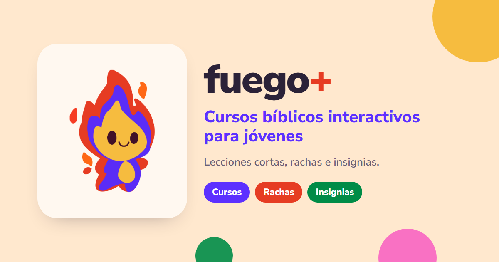

# Fuego+



**Cursos bíblicos interactivos para jóvenes, al estilo Duolingo.**

<!-- ⚠️ PENDIENTE: descripción en tus palabras -->
Fuego+ es una app de cursos bíblicos para jóvenes: lecciones cortas con actividades, un recorrido por cada curso, rachas e insignias por avanzar, y un panel para que los líderes den seguimiento.

> «¿No ardía nuestro corazón…?» — Lucas 24:32

**[Ver la app en vivo → fuego-youth-path.lovable.app](https://fuego-youth-path.lovable.app)**

<!-- ⚠️ PENDIENTE: agregar la cuenta de demostración
Cuenta de demostración: `correo@demo` / `contraseña`
-->

<!-- ⚠️ PENDIENTE: capturas de la app en docs/ y descomentar
| Inicio | Curso | Insignias |
|---|---|---|
|  |  |  |
-->

---

## Qué incluye

- **Inicio:** saludo, tarjetas de racha, XP, lecciones e insignias; el curso en progreso destacado; gráfico de actividad de la semana; tus cursos, anuncios y notificaciones.
- **Cursos:** cada curso con su propio ícono y color, y un mapa de recorrido donde cada lección se desbloquea al completar la anterior.
- **Lecciones interactivas** (ver abajo). Las lecciones que aún se están preparando muestran un aviso de «Estamos trabajando en el contenido».
- **Insignias:** premios por metas cumplidas (lecciones, XP, rachas, cursos completos), cada una con su ícono.
- **Ajustes:** perfil y avatar, meta diaria, modo oscuro, sonido, recordatorios y contraseña.
- **Panel de administración:**
  - **Estadísticas con gráficos:** lecciones completadas por día, actividad de los jóvenes, avance promedio por curso y los cinco con más XP.
  - **Seguimiento de cada joven:** su avance en cada curso.
  - **Anuncios** para todos los jóvenes.

## Las lecciones

El curso **Fundamentos de la fe** tiene 8 lecciones. La primera ya está desarrollada como experiencia completa:

### Religiones del mundo
Comparación entre el cristianismo y otras religiones mediante tarjetas que se voltean, una pila de tarjetas para deslizar y una actividad de «descartar» la afirmación que no corresponde.

## Diseño

- **Identidad visual propia:** paleta Fuego+ (violeta `#5C30FF`, coral `#E63C23`, rosa `#F971C3`, amarillo `#F6BC3F`, verde `#008C47` y crema `#FFE8CE`), mascota propia y tipografía Nunito Sans.
- **Íconos de línea** para cursos, insignias y ajustes en lugar de emojis, con colores de la paleta.
- **Tarjetas grandes y redondeadas** con títulos grandes y espacio generoso, inspiradas en apps de aprendizaje.
- **Arrastrar y soltar real** con mouse y pantallas táctiles (Pointer Events), sin bibliotecas adicionales.
- **Accesibilidad:** las animaciones de los gráficos se desactivan si el sistema pide movimiento reducido, y los estados no dependen solo del color.
- **Pensado primero para celular.**

## Tecnologías

- **React 19** con **TanStack Start / Router** y **TypeScript**
- **Tailwind CSS 4** y componentes **Radix UI**
- **Recharts** para los gráficos del panel de administración
- **Supabase**: autenticación, base de datos y progreso de los cursos
- Animaciones con CSS y SVG
- **Vitest** para pruebas
- Construida con **[Lovable](https://lovable.dev)** y desarrollo asistido con IA (Claude)

## Mi rol

<!-- ⚠️ PENDIENTE: ajustar con tu nombre y lo que hiciste -->
**[Tu nombre]**: idea y concepto del producto, contenido bíblico de las lecciones, dirección visual y de experiencia de usuario, definición de cada interacción, pruebas y revisión. El código se generó y se iteró con Lovable y con asistencia de IA, a partir de mis especificaciones.

## Próximos pasos

- [x] Plataforma base, mapa del curso, insignias y administración
- [x] Lección «Religiones del mundo»
- [x] Rediseño visual: inicio, cursos, insignias, ajustes y panel con estadísticas
- [ ] Las 7 lecciones restantes de *Fundamentos de la fe*: Jesús, Dios, Espíritu Santo, Pecado, Salvación, Oración e Iglesia
- [ ] Más cursos

## Ejecutar en local

Necesitas Node.js y npm.

```sh
git clone https://github.com/jpicadocorrales-png/fuego-youth-path.git
cd fuego-youth-path
npm install
npm run dev
```

El proyecto también se puede editar desde el [editor de Lovable](https://lovable.dev/projects/60ed0432-2e22-47b7-9510-a167f256003d); los cambios se sincronizan con este repositorio.
